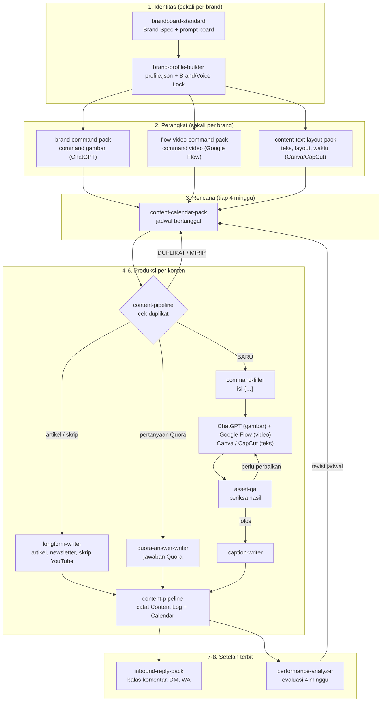
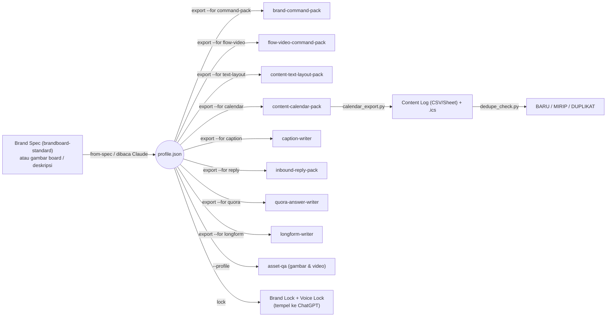

# Pawang Content Studio

Satu repositori (`pawang-content-studio`) berisi **14 skill Claude** yang tersambung menjadi satu alur kerja konten: dari **brand board**, **profil brand**, **command gambar dan video**, **teks dan layout**, **jadwal**, **caption**, **artikel dan skrip YouTube**, **jawaban Quora**, **QA hasil**, **balasan DM**, sampai **evaluasi performa**. Dibuat untuk dipakai di **Claude.ai** (maupun dijalankan lewat CLI Python lokal), dengan berkas datar (`.json`, `.csv`, `.ics`) dan konektor **Google Drive**, Google Calendar, Gmail, serta Notion sebagai ruang kerja.

Contoh brand di seluruh repo: **Pawang.dev** (maskot Si Liar). Semua skill bekerja untuk brand apa pun lewat satu berkas profil (`profile.json`).

---

## Daftar Isi

1. [Gambaran Alur](#1-gambaran-alur)
2. [Isi Repo: 14 Skill](#2-isi-repo-14-skill)
3. [Mulai Cepat](#3-mulai-cepat)
4. [Memasang Skill di Claude.ai](#4-memasang-skill-di-claudeai)
5. [Workspace dan MCP](#5-workspace-dan-mcp)
6. [Alur Kerja Harian dan Mingguan](#6-alur-kerja-harian-dan-mingguan)
7. [Aliran Data: Satu Profil untuk Semua](#7-aliran-data-satu-profil-untuk-semua)
8. [Struktur Folder Repo](#8-struktur-folder-repo)
9. [Tips dan Trik](#9-tips-dan-trik)
10. [Batasan yang Perlu Diketahui](#10-batasan-yang-perlu-diketahui)
11. [Pengembangan](#11-pengembangan)
12. [Kredit dan Lisensi](#12-kredit-dan-lisensi)

---

## 1. Gambaran Alur



Prinsip yang dipegang seluruh skill:

- **Satu sumber kebenaran**: `profile.json`, beserta **Brand Lock** (blok instruksi pengunci palet warna, font, logo, dan gaya visual untuk ditempel ke ChatGPT/Flow) dan **Voice Lock** (blok instruksi pengunci nada bicara, sapaan, dan kata terlarang untuk penulisan teks).
- **Pengisian prompt dua tahap**: saat paket command dibuat dari `profile.json`, token level brand `[[...]]` diisi otomatis oleh skrip; saat produksi harian per topik, isian kurung kurawal `{...}` diisi oleh `command-filler`.
- **Tidak mengarang**: harga, testimoni, angka hasil, dan kontak yang tidak Anda berikan ditandai `[ISI SENDIRI]`.
- **Semua prompt ada di code block** agar bisa disalin dengan satu klik.
- **Setiap hasil diperiksa skrip**: batas kata, batas karakter, zona aman, warna, duplikat, format.
- **Konfirmasi sebelum menulis** ke Drive, Sheets, Calendar, atau mengirim email.

### Masalah, Tujuan, dan Alasan Arsitektur

- **Masalah yang diselesaikan**: produksi konten UMKM dan tim kecil sering mengalami warna/suara brand yang berubah-ubah di tiap percakapan AI, topik yang berulang tanpa sengaja, serta ketiadaan pemeriksaan mutu sebelum unggah.
- **Tujuan (Goals)**: menyatukan identitas brand ke satu `profile.json`, mendeterministikan pembuatan prompt dan pemeriksaan mutu lewat skrip Python, serta menjaga jejak publikasi di `content-log.csv`.
- **Bukan Tujuan (Non-Goals)**: bukan alat *auto-publishing* API ke akun sosial media, bukan pengganti generator visual (ChatGPT/Google Flow) atau editor tata letak (Canva/CapCut), dan bukan sistem manajemen multi-pengguna waktu nyata (*real-time*).
- **Alternatif yang Dipertimbangkan**:
  1. *14 Skill Modular vs 1 Mega-Skill Monolitik*: satu skill tunggal yang memuat seluruh templat gambar, video, kalender, artikel, dan QA akan memenuhi *context window* di setiap percakapan. Memisahkan menjadi 14 skill menjaga konteks tetap fokus pada tahap yang sedang dikerjakan.
  2. *Berkas Datar (`profile.json`, `.csv`, `.ics`) vs Database/Server Khusus*: berkas datar dapat berjalan langsung di *sandbox* Claude.ai maupun terminal lokal tanpa instalasi server, mudah dibuka di Google Sheets/Calendar, dan tetap bekerja saat konektor MCP tidak tersedia.

---

## 2. Isi Repo: 14 Skill

| # | Skill | Tahap | Fungsi | Skrip |
|---|---|---|---|---|
| 0 | [`content-pipeline`](skills/content-pipeline) | pengarah | memilih skill per tahap; **cek konten ganda**; Content Log; kalender ke Calendar | `dedupe_check.py`, `calendar_export.py` |
| 1 | [`brandboard-standard`](skills/brandboard-standard) | identitas | brand board satu halaman dengan 16 section standar (7 wajib Tier 1, 7 kondisional Tier 2, 2 modul bisnis Tier 3), Brand Spec Markdown, audit | - |
| 2 | [`brand-profile-builder`](skills/brand-profile-builder) | identitas | `profile.json` tunggal, kontras warna WCAG, Brand/Voice Lock, ekspor ke skill lain | `profile.py` |
| 3 | [`brand-command-pack`](skills/brand-command-pack) | perangkat | ±40 command gambar untuk ChatGPT (logo, carousel, story, OG, iklan, mockup) | `build_pack.py` |
| 4 | [`flow-video-command-pack`](skills/flow-video-command-pack) | perangkat | ±16 command video untuk Google Flow + paket cerita 4 klip | `build_pack.py` |
| 5 | [`content-text-layout-pack`](skills/content-text-layout-pack) | perangkat | teks apa, di mana, detik berapa; layout carousel/story/reel | `build_pack.py` |
| 6 | [`content-calendar-pack`](skills/content-calendar-pack) | rencana | jadwal bertanggal: hari, jam WIB, topik, command | `build_pack.py` |
| 7 | [`command-filler`](skills/command-filler) | produksi | mengisi `{...}` pada command sampai siap tempel | `fill.py` |
| 8 | [`caption-writer`](skills/caption-writer) | produksi | caption per platform, hashtag, alt text | `captions.py` |
| 9 | [`asset-qa`](skills/asset-qa) | kendali mutu | cek ejaan, palet, zona aman, logo/karakter, glitch video; prompt perbaikan | `qa_image.py`, `qa_video.py`, `logo_compare.py`, `fixprompts.py` |
| 10 | [`inbound-reply-pack`](skills/inbound-reply-pack) | percakapan | alur dan 30+ template balasan komentar/DM/WA, eskalasi, Lead Tracker | `build_replies.py` |
| 11 | [`performance-analyzer`](skills/performance-analyzer) | belajar | analisis Insights (median, sampel kecil), revisi jadwal | `analyze.py` |
| 12 | [`quora-answer-writer`](skills/quora-answer-writer) | produksi | jawaban Quora yang bermanfaat dan jujur: cek kebijakan, pengungkapan brand, satu tautan | `answer_check.py` |
| 13 | [`longform-writer`](skills/longform-writer) | produksi | artikel blog SEO, Medium, LinkedIn Article, newsletter, skrip YouTube panjang berbasis riset | `article_check.py`, `script_check.py` |


### Cakupan platform

| Platform / format | Teks dan caption | Gambar / video | Jadwal | Skill utama | Catatan |
|---|---|---|---|---|---|
| Instagram (feed, carousel, story, reels) | ✅ | ✅ | ✅ | `caption-writer`, `brand-command-pack`, `flow-video-command-pack` | link caption tidak bisa diklik |
| TikTok | ✅ | ✅ video 9:16 | ✅ | sama | hashtag ikut batas karakter |
| LinkedIn (post) | ✅ | ✅ | ✅ | `caption-writer`, `brand-command-pack` | carousel biasanya diunggah sebagai dokumen PDF |
| X (Twitter) | ✅ 280 karakter | ✅ | ✅ | sama | |
| Threads | ✅ 500 karakter | ✅ `/xx-threads` | ✅ | sama | gaya percakapan |
| Facebook | ✅ | ✅ `/xx-fbpost`, `/xx-fbcover` | ✅ | sama | |
| Pinterest | ✅ | ✅ pin 2:3 | ✅ | sama | |
| YouTube Shorts | ✅ | ✅ | ✅ | sama | judul maks. 100 karakter |
| WhatsApp Status | ✅ | ✅ | ✅ | sama | |
| **Quora** | ✅ jawaban | tidak perlu | ✅ 1-2 per minggu | `quora-answer-writer` | kebijakan promosi/tautan/AI dicek saat dipakai |
| **Blog, Medium, LinkedIn Article** | ✅ artikel | ✅ gambar fitur `/xx-feature` | ✅ 2 per bulan | `longform-writer` | meta, slug, alt text, sumber |
| **Newsletter** | ✅ | opsional | opsional | `longform-writer` | satu CTA |
| **YouTube panjang** | ✅ skrip, bab | ✅ thumbnail `/xx-ytthumb` | ✅ opsional | `longform-writer` | bab minimal 3, tiap bab >= 10 detik |

Catatan notasi pada tabel di atas: `/xx-...` (misalnya `/xx-threads`, `/xx-ytthumb`) adalah kode command dengan `xx` mewakili awalan 2–3 huruf brand (`prefix` di `profile.json`, contohnya `/pw-threads` untuk Pawang.dev).

Semua adalah **bahan siap dipakai**, bukan unggahan otomatis: gambar dan video tetap dibuat di ChatGPT/Flow, diberi teks di Canva/CapCut, diperiksa dengan `asset-qa`, lalu diunggah sendiri.

Rincian tiap skill (pemicu, input, output): [`docs/KATALOG-SKILL.md`](docs/KATALOG-SKILL.md).

---

## 3. Mulai Cepat

1. **Pasang 14 skill** di Claude.ai (bagian 4). Berkas siap unggah ada di [`dist/`](dist).
2. **Pasang konektor** minimal Google Drive (bagian 5), lalu buat folder brand sesuai [`templates/folder-structure.md`](templates/folder-structure.md).
3. **Buat identitas**: di Claude ketik *"Buatkan brand board standar untuk NamaBrand ..."*, lalu *"Buat profil brand dari Brand Spec ini"*. Simpan `profile.json` di `00-Brand/`.
4. **Buat perangkat**: *"Buatkan file command gambar"*, *"Buatkan command video untuk Flow"*, *"Buatkan panduan teks dan layout"*. Simpan di `03-Command/`.
5. **Buat jadwal**: *"Buatkan jadwal konten 4 minggu mulai Senin depan, paket Ringan"* (`Ringan` = 3 konten utama/minggu; tersedia juga `Standar` = 5–7 konten utama/minggu), lalu *"Ekspor ke Content Log dan Calendar"*.
6. **Produksi satu konten**: cek duplikat, isi command, buat gambar/video di ChatGPT/Flow, tambah teks di Canva/CapCut, QA, caption, jadwalkan, catat.
7. **Setelah 4 minggu**: unggah CSV Insights, *"Analisis dan revisi jadwal"*.

Coba lebih dulu tanpa risiko: jalankan uji asap `python scripts/smoke_test.py` dan lihat hasil contoh di [`examples/pawang-dev/generated/`](examples/pawang-dev/generated).

---

## 4. Memasang Skill di Claude.ai

**Prasyarat**: *Code execution and file creation* aktif (Settings > Capabilities untuk akun individu; pengaturan organisasi untuk Team/Enterprise). Tanpa ini skill tidak jalan atau tampil abu-abu.

**Langkah** (nama menu bisa berbeda antarversi aplikasi; ikuti pusat bantuan Claude bila berbeda):

1. Buka **Customize > Skills** (atau **Settings > Capabilities > Skills** pada tampilan lama).
2. Pilih tambah skill (**+ > Upload a skill** / **Upload skill**).
3. Pilih **satu** berkas dari `dist/`, misalnya `dist/content-pipeline.skill`.
4. Ulangi untuk ke-14 berkas, lalu pastikan semuanya **aktif** (toggle on).

**Aturan penting**

- **Satu ZIP = satu skill.** Jangan menggabungkan beberapa skill ke satu ZIP.
- Akar ZIP adalah folder skill, dan **nama folder harus sama dengan `name`** di `SKILL.md` (sudah benar di `dist/`).
- Skill yang Anda unggah **bersifat pribadi** untuk akun Anda. Untuk tim, gunakan fitur pemberian skill organisasi (Team/Enterprise).
- **Memperbarui**: hapus versi lama, lalu unggah `.skill` yang baru.
- Jika Claude.ai menolak unggahan karena **panjang deskripsi**, gunakan berkas di [`dist-short/`](dist-short) (deskripsi `<= 200` karakter).
- Urutan unggah yang disarankan: `content-pipeline`, `brandboard-standard`, `brand-profile-builder`, lalu sisanya.
- Simpan `profile.json` dan berkas command di **Claude Projects** (*Project Knowledge*) agar semua percakapan baru otomatis memiliki akses ke identitas brand tanpa unggah berulang.

**Memicu skill**: skill aktif otomatis ketika permintaan cocok dengan deskripsinya. Jika tidak terpicu, sebut namanya secara eksplisit: *"Gunakan skill asset-qa untuk memeriksa gambar ini."*

### Plugin marketplace (Claude Code, Codex, Antigravity, claude.ai)

Selain unggah per skill, repo ini juga marketplace plugin yang memasang ke-14 skill sekaligus: `/plugin marketplace add OWNER/pawang-content-studio` (Claude Code), `codex plugin marketplace add OWNER/pawang-content-studio` (Codex), `agy plugin install https://github.com/OWNER/pawang-content-studio` (Antigravity), dan sinkron GitHub di admin organisasi claude.ai. Panduan lengkap: [`docs/MARKETPLACE.md`](docs/MARKETPLACE.md).

---

## 5. Workspace dan MCP

Jalur dasar yang teruji penuh bekerja melalui berkas (`profile.json`, `content-log.csv`, `jadwal.ics`, dan `.md`). Konektor (MCP) bersifat opsional untuk menghubungkan Claude ke ruang kerja Anda (konektor bawaan umumnya untuk **membaca** dokumen Drive/Notion atau membuat **draf** Gmail/event Calendar; penulisan langsung ke Google Sheets/Drive membutuhkan konektor MCP dengan izin tulis, atau dilakukan lewat unduh/impor `content-log.csv` dan `jadwal.ics`).

| Prioritas | Konektor | Dipakai untuk |
|---|---|---|
| **1 (disarankan)** | **Google Drive + Sheets** | menyimpan `profile.json`, aset, laporan; **Content Log** untuk cek konten ganda; Lead Tracker; data Insights |
| 2 | **Google Calendar** | event posting, blok produksi, evaluasi tiap 4 minggu, jadwal konsultasi |
| 3 | **Gmail** | **draf** konfirmasi konsultasi, follow-up, laporan mingguan |
| 4 | **Notion** | papan Kanban status konten, SOP, FAQ |
| 5 | Slack (opsional) | notifikasi internal |

### Kenapa Drive paling penting: anti konten ganda

1. Jadwal konten disimpan sebagai **Content Log** (Google Sheet): satu baris per konten dengan topik, hook, platform, format, status, tautan aset, dan tautan post.
2. Sebelum membuat konten baru, `content-pipeline` **membaca Content Log dan folder aset**, lalu menjalankan `dedupe_check.py`.
3. Hasilnya **BARU** (lanjut), **MIRIP** (ubah sudut atau daur ulang), atau **DUPLIKAT** (jangan buat ulang).
4. Setelah konten lolos QA, baris log diperbarui (status `jadi`, `terjadwal`, `terbit`) dan aset disimpan di `02-Aset/YYYY-MM/YYYY-MM-DD_format_slug/`.

```text
<Nama Brand>/
├── 00-Brand/        profile.json, brand-spec.md, brand-board.png, logo/
├── 01-Kalender/     Content Log (Sheet), jadwal-<bulan>.md
├── 02-Aset/         2026-10/2026-10-26_carousel_4-tanda-data-liar/
├── 03-Command/      file command gambar, video, teks
├── 04-Insights/     ekspor CSV per bulan
├── 05-Leads/        Lead Tracker (Sheet)
└── 06-Laporan/      laporan performa dan QA
```

Jalur tanpa konektor: unduh `content-log.csv`, tempel ke percakapan, dan impor `jadwal.ics` ke Google Calendar.

**Aturan keamanan**: Claude meminta **konfirmasi sebelum menulis atau mengirim**; email hanya dibuat sebagai **draf**; isi dokumen/email yang dibaca dianggap data (bukan perintah); Lead Tracker tanpa kata sandi, OTP, KTP, atau data kartu. Detail dan diagram: [`docs/WORKSPACE-MCP.md`](docs/WORKSPACE-MCP.md).

> Nama alat konektor berbeda tiap akun. Di awal sesi minta Claude: *"Konektor apa yang aktif? Baca profile.json dan Content Log."* Skrip lokal (CSV, ICS, deteksi duplikat) telah diuji lewat `smoke_test.py`; selalu periksa ringkasan perubahan yang ditampilkan Claude sebelum menyetujui penulisan ke Drive, Sheets, atau Calendar.

---

## 6. Alur Kerja Harian dan Mingguan

| Waktu | Kegiatan | Skill |
|---|---|---|
| Jumat sore | pilih topik pekan depan, **cek duplikat** | `content-calendar-pack`, `content-pipeline` |
| Senin | isi command, tulis teks dan caption | `command-filler`, `content-text-layout-pack`, `caption-writer` |
| Selasa | buat gambar (ChatGPT) dan video (Flow) | command gambar dan video |
| Rabu | susun di Canva/CapCut, **QA**, jadwalkan, catat ke Content Log | `asset-qa`, `content-pipeline` |
| Setiap hari | balas komentar, DM, WhatsApp | `inbound-reply-pack` |
| Tiap 4 minggu | evaluasi, revisi kalender | `performance-analyzer` |

Detail per tahap, contoh kalimat yang diketik, dan keluaran: [`docs/ALUR-KERJA.md`](docs/ALUR-KERJA.md).

---

## 7. Aliran Data: Satu Profil untuk Semua



Mengganti warna, CTA, atau layanan: ubah **`profile.json` saja**, lalu ekspor ulang. Jangan mengedit file turunan satu per satu. Skema: [`skills/brand-profile-builder/references/profile-schema.md`](skills/brand-profile-builder/references/profile-schema.md).

---

## 8. Struktur Folder Repo

```text
pawang-content-studio/
├── README.md                      # dokumen ini
├── requirements.txt               # dependensi Python untuk asset-qa & brand-profile-builder
├── skills.json                    # daftar skill + deskripsi pendek (<= 200 karakter)
├── skills/                        # SUMBER: satu folder per skill (nama folder = name di SKILL.md)
│   ├── content-pipeline/          #   SKILL.md, scripts/, references/, templates/, evals/
│   ├── brandboard-standard/       #   SKILL.md, assets/, references/, evals/
│   ├── brand-profile-builder/     #   SKILL.md, scripts/profile.py, references/, evals/
│   ├── brand-command-pack/        #   SKILL.md, scripts/{build_pack,catalog}.py, references/, evals/
│   ├── flow-video-command-pack/   #   SKILL.md, scripts/{build_pack,catalog}.py, references/, evals/
│   ├── content-text-layout-pack/  #   SKILL.md, scripts/build_pack.py, references/, evals/
│   ├── content-calendar-pack/     #   SKILL.md, scripts/build_pack.py, references/, evals/
│   ├── command-filler/            #   SKILL.md, scripts/fill.py, references/, evals/
│   ├── caption-writer/            #   SKILL.md, scripts/captions.py, references/, evals/
│   ├── asset-qa/                  #   SKILL.md, scripts/{qa_image,qa_video,logo_compare,fixprompts}.py, references/, evals/
│   ├── inbound-reply-pack/        #   SKILL.md, scripts/build_replies.py, references/, evals/
│   ├── performance-analyzer/      #   SKILL.md, scripts/analyze.py, references/, evals/
│   ├── quora-answer-writer/       #   SKILL.md, scripts/answer_check.py, references/, evals/
│   └── longform-writer/           #   SKILL.md, scripts/{article_check,script_check}.py, templates/, references/, evals/
├── dist/                          # HASIL KEMAS: 14 berkas .skill, siap diunggah ke Claude.ai
├── dist-short/                    # versi cadangan: deskripsi <= 200 karakter
├── .claude-plugin/                # marketplace.json untuk Claude Code dan claude.ai (dibuat build_plugins.py)
├── .agents/plugins/               # marketplace.json untuk Codex (dibuat build_plugins.py)
├── .antigravity-plugin/           # plugin.json agy untuk instal dari URL GitHub (dibuat build_plugins.py)
├── plugins/pawang-content-studio/ # HASIL GENERASI: 14 skill (tanpa evals/) + manifest tiga platform
├── docs/
│   ├── ALUR-KERJA.md              # 8 tahap utama (11 langkah), kalimat yang diketik, keluaran
│   ├── WORKSPACE-MCP.md           # Drive, Sheets, Calendar, Gmail, Notion, keamanan
│   ├── KATALOG-SKILL.md           # pemicu, input, output tiap skill
│   ├── TIPS-TRIK.md
│   └── TROUBLESHOOTING.md
├── templates/                     # templat siap impor ke Sheets / panduan folder Drive
│   ├── content-log.csv
│   ├── insights.csv
│   ├── lead-tracker.csv
│   └── folder-structure.md
├── examples/
│   └── pawang-dev/
│       ├── brand-spec.md          # contoh Brand Spec
│       ├── profile.json           # contoh profil lengkap
│       ├── artikel-contoh.md      # contoh artikel (front matter + FAQ + sumber)
│       ├── skrip-youtube-contoh.md # contoh skrip dengan bab
│       ├── jawaban-quora-contoh.md # contoh jawaban Q&A
│       └── generated/             # keluaran contoh dari smoke test (command, jadwal, caption, balasan, CSV, ICS)
└── scripts/
    ├── build_all.py               # validasi semua skill + kemas ke dist/ (--short untuk dist-short/)
    ├── build_plugins.py           # sinkronkan plugins/ + manifest marketplace (--check untuk CI, --zip untuk admin claude.ai)
    └── smoke_test.py              # uji alur end-to-end dengan brand contoh
```

**Catatan struktur**

- `skills/` adalah sumber yang Anda edit; `dist/` dibuat ulang oleh `build_all.py`.
- Folder `evals/` di tiap skill berisi dua kasus uji (prompt, hasil yang diharapkan, penilai) dan **tidak ikut** dikemas ke `.skill`.
- Skrip tiap skill mandiri (hanya pustaka standar Python, kecuali `asset-qa` yang memakai Pillow/numpy dan opsional OpenCV, Tesseract, ffmpeg).

---

## 9. Tips dan Trik

**Bekerja dengan Claude**
- Sebut nama skill bila tidak terpicu: *"Gunakan skill `command-filler` ..."*.
- Satu tahap per percakapan; mulai percakapan baru dengan mengunggah `profile.json`.
- Tempel hanya command yang dibutuhkan, bukan seluruh file.
- Selalu sebut **format tujuan** (story 9:16, reels, feed 4:5) agar layout dan QA tepat.

**Gambar dan video**
- Tempel **Brand Lock** di Project ChatGPT; unggah brand board di tiap percakapan baru.
- **Carousel satu slide per permintaan**; teks pada gambar **pendek dan dieja persis**; teks panjang tambahkan di Canva.
- Video: **satu klip, satu aksi, satu gerakan kamera**; **tanpa teks di dalam video**; karakter konsisten lewat **Ingredients** (fitur unggah gambar acuan karakter/objek di Google Flow agar wujud maskot tetap sama antar-klip).
- Uji **satu** gambar/klip sebelum membuat semuanya agar kredit tidak terbuang.

**Jadwal dan konsistensi**
- Mulai paket **Ringan** (3 konten utama per minggu); konsisten lebih penting daripada banyak.
- **Produksi batch** sekali seminggu, jadwalkan sekali.
- **Jam posting adalah hipotesis**; uji 4 minggu dengan Insights akun Anda sendiri, ubah satu variabel pada satu waktu.
- Satu topik menjadi 10 konten (carousel, reel, story, kartu tips, thread, pin, blog).

**Anti duplikat**
- Cek duplikat **sebelum produksi**; isi kolom **Hook** dan **Slug** di Content Log.
- **MIRIP bukan larangan**: ubah sudut, platform, atau format.
- Catat konten yang terbit **segera**.

**Kualitas dan data**
- Baca teks gambar **dengan mata**; OCR hanya pembantu.
- Dua kali perbaikan gagal: buat ulang.
- Ikuti **tabel kontras**: warna aksen untuk tombol/ikon, bukan teks panjang.
- `[ISI SENDIRI]` adalah fitur: skill tidak akan mengarang harga, testimoni, atau angka hasil.

**Konten panjang dan Q&A**
- Mulai dari **bahan nyata** (pengalaman, contoh, data milik Anda); skill menambah riset bersumber, bukan mengarang.
- Satu artikel menjadi banyak konten (carousel, reel, Threads, jawaban Quora, newsletter); rencananya ada di keluaran `longform-writer`.
- **Quora**: jawab pertanyaan yang benar-benar Anda kuasai, ungkapkan hubungan dengan brand, paling banyak satu tautan, dan baca kebijakan terbaru platform. Jangan menempel jawaban yang sama di banyak pertanyaan.
- Cek apakah **Medium/LinkedIn/komunitas** meminta pengungkapan bantuan AI, dan sunting draf sendiri sebelum terbit.

**Percakapan klien**
- Komentar singkat, detail di DM; keluhan jangan didebat di publik.
- Jangan pernah meminta atau menyimpan kata sandi/OTP lewat chat.
- Pesan otomatis hanya untuk di luar jam layanan dan kata kunci, bukan untuk harga atau komplain.

Daftar lengkap: [`docs/TIPS-TRIK.md`](docs/TIPS-TRIK.md). Masalah umum: [`docs/TROUBLESHOOTING.md`](docs/TROUBLESHOOTING.md).

---

## 10. Batasan yang Perlu Diketahui

- **Pengujian**: `python scripts/smoke_test.py` memverifikasi rantai skrip deterministik (18 langkah). Setiap skill juga dilengkapi 2 kasus uji di folder `skills/<nama>/evals/` untuk menguji respons Claude secara manual.
- **Batas karakter dan zona aman**: angka batas karakter di `captions.py` dan zona aman piksel di `qa_image.py` adalah patokan konservatif; verifikasi dengan satu postingan uji pada aplikasi target.
- **OCR pada `asset-qa`**: `qa_image.py` otomatis menggunakan bahasa `ind+eng` bila paket `tesseract-ocr-ind` terpasang, atau kembali ke `eng`. Karena font dekoratif sering meleset dibaca OCR, konfirmasi visual tetap wajib.
- **Pemeriksa duplikat leksikal**: `dedupe_check.py` menghitung kemiripan token, imbuhan dasar, dan `Slug` (ambang `MIRIP >= 0.55`, `DUPLIKAT >= 0.80`), bukan makna semantik lintas sinonim; isi kolom `Hook` serta `Slug` secara konsisten dan tinjau tabel kandidat dengan mata.
- **Kebijakan platform pihak ketiga**: skrip pemeriksa (`answer_check.py`, `article_check.py`) memvalidasi struktur, klaim berlebihan, dan aturan tautan secara lokal, sedangkan aturan terbaru Quora/Medium/LinkedIn diperiksa oleh Claude lewat pencarian web saat skill dijalankan.

---

## 11. Pengembangan

Saat digunakan di Claude.ai, skrip di dalam tiap skill dijalankan otomatis oleh Claude di dalam *sandbox* eksekusi kode. Untuk pengembangan atau eksekusi langsung di komputer lokal, gunakan **Python 3.9+**:

```bash
# pasang dependensi Python untuk asset-qa dan ekstraksi warna
pip install -r requirements.txt
# opsional (sistem): pasang tesseract-ocr (+ tesseract-ocr-ind) dan ffmpeg untuk OCR gambar & QA video

# validasi semua skill + kemas ke dist/
python scripts/build_all.py

# juga buat dist-short/ (deskripsi <= 200 karakter)
python scripts/build_all.py --short

# validasi saja / satu skill
python scripts/build_all.py --check
python scripts/build_all.py --only asset-qa caption-writer

# uji alur end-to-end (menulis contoh ke examples/pawang-dev/generated/)
python scripts/smoke_test.py
```

**Menambah skill baru**:
1. Buat `skills/<nama>/SKILL.md` (frontmatter `name` sama dengan nama folder; `description` satu baris tanpa `: ` bila tidak diberi tanda kutip) dan minimal 2 kasus uji di `skills/<nama>/evals/`.
2. Daftarkan di `skills.json` beserta `short_description` (`<= 200` karakter).
3. Jika skill membaca ekspor dari `profile.json`, tambahkan nama target dan field wajibnya ke `TARGET_REQ` serta percabangan `export()` di `skills/brand-profile-builder/scripts/profile.py`, lalu tambahkan langkah ujinya di `scripts/smoke_test.py`.
4. Jalankan `python scripts/build_all.py --short`, `python scripts/build_plugins.py`, dan `python scripts/smoke_test.py`.

**Menambah command permanen**:
- **Gambar (`skills/brand-command-pack/scripts/catalog.py`)**: tambahkan tuple 6 elemen `(name, description, size, requires, singkat, detail)` ke `SECTIONS`. Token `[[...]]` yang tersedia dihitung di `build_tokens()` pada `build_pack.py` (`[[BRAND]]`, `[[BRAND_SHORT]]`, `[[P]]`, `[[TAGLINE]]`, `[[CTA]]`, `[[CTA_SHORT]]`, `[[URL]]`, `[[HANDLE]]`, `[[LOGO_DESC]]`, `[[STYLE]]`, `[[TONE]]`, `[[FONT_H]]`, `[[FONT_B]]`, `[[DARK]]`, `[[ACCENT]]`, `[[LIGHT]]`, `[[SUPPORT]]`, `[[OFFWHITE]]` beserta `*_NAME`, `[[MASCOT]]`, `[[M_MAIN]]`, `[[SERVICES_LIST]]`, `[[PACKAGES_NAMES]]`).
- **Video (`skills/flow-video-command-pack/scripts/catalog.py`)**: tambahkan entri `E(name, desc, mode, blocks, requires=..., alt=...)` ke `SECTIONS`. Token `[[...]]` yang tersedia dihitung di `tokens()` pada `build_pack.py` (`[[BRAND]]`, `[[PI]]`, `[[P]]`, `[[SUBJ]]`, `[[WORLD]]`, `[[PROBLEM]]`, `[[SOLUTION]]`, `[[STORY_THEME]]`, `[[IMG_CMD]]`, `[[SERVICES_LIST]]`, dan token warna).
- Biarkan isian per topik dalam kurung kurawal `{...}` untuk diisi pengguna melalui `command-filler`.

**Mengubah brand**: salin `examples/pawang-dev/`, ganti `profile.json` (atau jalankan `profile.py from-spec brand-spec.md`), lalu ekspor ulang dengan `profile.py export`.

**Perintah berguna per skill**

```bash
# cetak contoh profile.json lengkap
python skills/brand-profile-builder/scripts/profile.py --example
# validasi struktur profile.json + tabel kontras WCAG
python skills/brand-profile-builder/scripts/profile.py validate profile.json
# cetak blok teks Brand Lock + Voice Lock siap tempel
python skills/brand-profile-builder/scripts/profile.py lock profile.json
# cek kemiripan topik terhadap log CSV dalam 120 hari terakhir
python skills/content-pipeline/scripts/dedupe_check.py content-log.csv --topic "..." --days 120
# ubah kalender Markdown (dari content-calendar-pack) ke CSV log + jadwal ICS dengan ID berawalan PW
python skills/content-pipeline/scripts/calendar_export.py jadwal.md --csv log.csv --ics jadwal.ics --prefix pw
# periksa gambar terhadap zona aman story, palet profile.json, dan daftar teks wajib (dipisah '|')
python skills/asset-qa/scripts/qa_image.py hasil.png --format story --profile profile.json --expect "Teks 1|Teks 2"
# analisis CSV Insights ke laporan Markdown + keluaran saran terstruktur JSON
python skills/performance-analyzer/scripts/analyze.py insights.csv --out laporan.md --json saran.json
```

---

## 12. Kredit dan Lisensi

Skill `brandboard-standard` dibuat oleh pemilik repositori; ketiga belas skill lainnya dikembangkan bersama Claude sebagai satu rangkaian terpadu dan diuji dengan brand contoh Pawang.dev. Tambahkan berkas `LICENSE` sesuai lisensi yang dipilih sebelum memublikasikan repositori secara terbuka.
