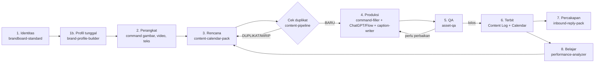

# Alur Kerja Lengkap

Delapan tahap utama (11 langkah termasuk sub-tahap 1b, 3b, dan 4b) dari nol sampai belajar dari data. Tiap tahap menyebut: **skill**, **yang Anda ketik di Claude.ai**, **keluaran**, dan **tempat menyimpan** (folder mengikuti `templates/folder-structure.md`).

## Tahap 1: Identitas

| Bagian | Detail |
|---|---|
| Skill | `brandboard-standard` lalu `brand-profile-builder` |
| Ketik | "Buatkan brand board standar untuk *NamaBrand* (tagline ..., warna ..., karakter ...)" lalu "Buat profil brand dari Brand Spec ini" |
| Keluaran | Brand Spec `.md`, prompt gambar brand board, `profile.json`, Brand Lock, Voice Lock, tabel kontras warna |
| Simpan | `00-Brand/` |

Jika brand board sudah ada (gambar), lewati `brandboard-standard` dan unggah gambarnya ke `brand-profile-builder`. Periksa tabel kontras: pasangan yang **TIDAK LOLOS** tidak boleh jadi warna teks.

## Tahap 2: Perangkat (sekali per brand)

| Skill | Ketik | Keluaran |
|---|---|---|
| `brand-command-pack` | "Buatkan file command konten untuk ChatGPT dari profil ini" | ±40 command `/xx-...` untuk gambar (logo, carousel, story, OG, iklan, mockup) |
| `flow-video-command-pack` | "Buatkan command video untuk Google Flow" | ±16 command `/xx-v-...` + paket cerita 4 klip |
| `content-text-layout-pack` | "Buatkan panduan teks, layout, dan waktu untuk Canva dan CapCut" | tabel teks, zona aman, detik tampil, command `/xx-t-...` |

Simpan di `03-Command/`. Tempel **Brand Lock** (gambar) dan **Voice Lock** (teks) di Project/Custom Instructions ChatGPT agar tidak perlu menempel ulang.

## Tahap 3: Rencana

| Bagian | Detail |
|---|---|
| Skill | `content-calendar-pack` |
| Ketik | "Buatkan jadwal konten 4 minggu mulai Senin depan, paket Ringan" |
| Keluaran | kalender bertanggal (hari, jam WIB, platform, format, pilar, topik, command), gudang topik, alur produksi |
| Lanjut | `content-pipeline` mengekspor ke `content-log.csv` (Sheets) dan `.ics` (Calendar) |

Mulai dengan paket **Ringan** (3 konten utama per minggu). Konsisten lebih penting daripada banyak.

## Tahap 3b: Cek duplikat (sebelum produksi)

| Bagian | Detail |
|---|---|
| Skill | `content-pipeline` |
| Ketik | "Cek apakah topik minggu ini sudah pernah dibuat" |
| Proses | Claude membaca Content Log (Sheet) dan folder `02-Aset`, menjalankan `dedupe_check.py` |
| Hasil | BARU: lanjut. MIRIP: ubah sudut atau daur ulang. DUPLIKAT: pilih topik lain |

## Tahap 4: Produksi (per konten)

1. **Isi command**: `command-filler`. Ketik "Isikan command ini untuk topik *X*: (tempel command)". Keluaran: command tanpa `{}`; data wajib dari Anda ditandai `[ISI SENDIRI]`.
2. **Buat gambar/video** di ChatGPT (gambar) dan Google Flow (video). Tempel Brand Lock dan upload brand board. Untuk carousel, satu slide per permintaan. Video: satu aksi per klip, tanpa teks di dalam video.
3. **Teks di editor**: tambahkan teks dan logo di Canva atau CapCut memakai panduan teks (posisi, ukuran, detik tampil).
4. **Caption**: `caption-writer`. Ketik "Tulis caption untuk carousel ini di Instagram, TikTok, dan LinkedIn". Keluaran: caption per platform, hashtag, alt text, komentar pertama.

## Tahap 4b: Konten panjang dan Q&A

| Kebutuhan | Skill | Ketik | Keluaran |
|---|---|---|---|
| Artikel blog / Medium / LinkedIn Article | `longform-writer` | "Buatkan artikel 1.000 kata tentang *topik kalender*; ini pengalaman saya: ..." | `.md` berfront matter, sumber, paket penerbitan, rencana daur ulang |
| Newsletter | `longform-writer` | "Buatkan newsletter minggu ini dari artikel tadi" | subjek, preheader, isi, satu CTA |
| Skrip YouTube | `longform-writer` | "Buatkan skrip video 8 menit tentang ..." | skrip bertanda `[mm:ss]`, catatan visual, daftar bab untuk deskripsi |
| Jawaban Quora | `quora-answer-writer` | "Buatkan jawaban untuk pertanyaan Quora ini: ... Saya benar-benar berpengalaman di ..." | jawaban ringkas dan lengkap, ringkasan kebijakan, pemeriksaan |

Bahan nyata dari Anda (pengalaman, contoh, data) membuat tulisan kuat; skill menambah riset bersumber dan tidak mengarang. Cek duplikat berlaku juga untuk topik artikel dan pertanyaan Quora.

## Tahap 5: QA (sebelum unggah)

| Bagian | Detail |
|---|---|
| Skill | `asset-qa` |
| Ketik | Unggah gambar/video + "Cek hasil ini. Format story. Teks yang seharusnya: ..." |
| Keluaran | keputusan (layak unggah / perbaiki dulu / buat ulang), tabel temuan, prompt perbaikan siap tempel |

Satu masalah per prompt perbaikan. Jika dua kali perbaikan gagal, buat ulang.

## Tahap 6: Terbit dan catat

`content-pipeline`: perbarui baris di **Content Log** (status: jadi, terjadwal, terbit; isi tautan aset dan tautan post), simpan aset di `02-Aset/YYYY-MM/YYYY-MM-DD_format_slug/`, buat event Calendar bila perlu. Claude selalu meminta konfirmasi sebelum menulis ke Drive, Sheets, atau Calendar.

## Tahap 7: Percakapan masuk

| Bagian | Detail |
|---|---|
| Skill | `inbound-reply-pack` |
| Ketik | "Buatkan paket balasan komentar, DM, dan WhatsApp" atau tempel pesan: "Balas pesan ini: ..." |
| Keluaran | alur 8 tahap, 30+ template, aturan eskalasi, format Lead Tracker |

Lengkapi `[ISI SENDIRI]` (harga, nomor WhatsApp, tautan booking, kebijakan diskon) sebelum dipakai.

## Tahap 8: Belajar (tiap 4 minggu)

| Bagian | Detail |
|---|---|
| Skill | `performance-analyzer` lalu `content-calendar-pack` |
| Ketik | Unggah CSV Insights + "Analisis 4 minggu ini dan revisi jadwal" |
| Keluaran | laporan (median, sampel kecil ditandai), maksimal 3 rekomendasi, kalender baru |

Data minimal 8 posting, ideal 20+. Ubah satu hal pada satu waktu.

## Siklus per minggu (ringkas)

| Hari | Kegiatan |
|---|---|
| Jumat sore | pilih topik pekan depan, cek duplikat |
| Senin | isi command, tulis teks dan caption |
| Selasa | buat gambar dan video |
| Rabu | susun di Canva/CapCut, QA, jadwalkan, catat ke Content Log |
| Setiap hari | balas komentar dan DM |
| Tiap 4 minggu | evaluasi dan revisi jadwal |
